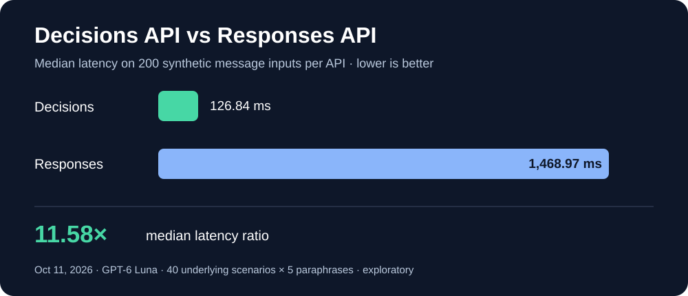

# OpenAI Decisions API vs Responses API — benchmark

A reproducible, exploratory comparison of **OpenAI's Decisions API** (`POST /v1/decisions`) and **Responses API** (`POST /v1/responses`) for classifying customer-support requests into **Billing, Technical, Shipping, or Other**, using `gpt-6-luna` for both workflows.

## Results — extended benchmark (October 11, 2026)



| Metric | Decisions API | Responses API |
| --- | ---: | ---: |
| Measured requests | 200 | 200 |
| Correct classifications | 198 | 194 |
| Accuracy | **99.0%** | 97.0% |
| Median latency | **126.84 ms** | 1,468.97 ms |
| P95 latency (nearest rank) | **183.70 ms** | 2,263.81 ms |
| API failures | 0 | 0 |

**Observed median latency ratio: 11.58×** (Responses / Decisions). This measures these two *application workflows*, not universal API speed or equal internal model work.

### What stood out

- Both APIs classified every Billing, Technical, and Shipping example correctly. All errors were in the **Other** category (Decisions: 48/50; Responses: 44/50).
- The APIs did not always misclassify the same examples: aggregate accuracy hides differences in error behavior.
- The benchmark used **200 distinct message strings but only 40 underlying scenarios, each paraphrased five times**. Treat the samples as correlated—not 200 independent business situations.

See [the full report](extended_report.md), [raw measurements](extended_results.csv), and [extended dataset](dataset_200.json).

## Run the extended benchmark (WSL/Linux)

Requires Python 3, `python3-venv`, an OpenAI API key, and available API credit.

```bash
bash run_extended.sh
```

The launcher creates a Python virtual environment if needed, asks for the API key (hidden input), and **requires typing `RUN`** before sending **400 billable requests**. It makes **no retries** and performs no warm-up requests in the extended run. **Running it again incurs new API charges and overwrites the extended result files.** Do not rerun just to view the published results.

For further setup detail, see [EXTENDED_README.md](EXTENDED_README.md). Do not commit API keys.

## Experiment design and interpretation

- Same underlying model, four predefined categories, one measured call per API per message.
- Decisions uses a typed `choice` interface; Responses uses structured JSON. Different output contracts and prompts are unavoidable, so the workloads are not perfectly identical.
- Requests were measured from one environment on one occasion; network and provider conditions affect latency.
- Synthetic labels are template-assigned and **have not been independently adjudicated**. Some category boundaries may be ambiguous.
- Reported accuracy is conditional on successful requests; failures are counted separately. A four-percentage-point difference on correlated synthetic examples is **not proof of a general accuracy advantage**.
- Decision confidence values are model estimates, **not calibrated probabilities**.
- Dollar costs have not been independently compared; consult actual OpenAI Platform usage/billing.
- Do not upload real customer personal data or confidential records for experiments without appropriate authorization.

Official API documentation: https://developers.openai.com/api/docs/guides/decisions

## Initial benchmark (v0.1 baseline)

The first experiment used **24 unique examples × 3 repetitions per API** (144 measured calls). Both workflows classified **69/72 correctly (95.8%)**, with median latencies of **187.4 ms (Decisions)** and **1,590.3 ms (Responses)**. The initial dataset, runner and results are retained in [dataset.json](dataset.json), [benchmark.py](benchmark.py), and [results.csv](results.csv).

Windows PowerShell launcher for the *initial* experiment:

```powershell
powershell -NoProfile -ExecutionPolicy Bypass -File .\run.ps1
```

Linux/WSL launcher for the *initial* experiment: `bash run.sh`. These launchers make additional paid requests.

## Repository contents

| File | Purpose |
| --- | --- |
| `benchmark_extended.py`, `run_extended.sh` | Extended benchmark and one-command launcher |
| `dataset_200.json` | 200 synthetic message strings |
| `extended_results.csv`, `extended_report.md` | Extended raw results and summary |
| `assets/extended-latency.svg` | Shareable GitHub chart |
| `benchmark.py`, `dataset.json`, `results.csv` | Original baseline and data |
| `run.sh`, `run.ps1` | Initial benchmark launchers |
| `LICENSE` | MIT license |

## Potential extensions

Independently review the gold labels, test diverse real-world-like scenarios, repeat on different days, evaluate confidence calibration and human-review thresholds, and compare actual billed costs. None of these additional calls are necessary to inspect the current published results.
